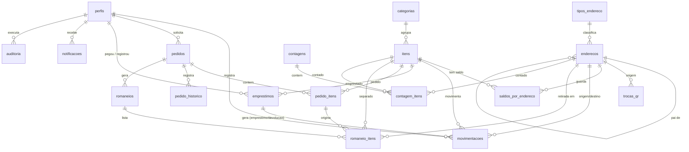

# Modelo de dados: Inventário Robótica

> Atualizado na v0.12.0 (migration 0009, Bloco 12): funções de leitura `posicoes_da_contagem` e `itens_para_contar`
> (situação de cada posição/item da contagem, sem devolver quantidades); nenhuma tabela nova.
> Atualizado na v0.8.2 (migration 0008, Bloco 8B): bucket `itens-fotos` no Storage; `itens.foto_url` guarda o CAMINHO no bucket;
> view `vw_itens_estoque` (saldo total, emprestado, abaixo do mínimo); trigger `proteger_item` (unidade e tipo de controle
> não mudam depois que há histórico; mínimo inteiro em "un").
> Atualizado na v0.8.1 (migration 0007): tabela `emprestimo_perdas` (uma linha por perda, imutável, `chave_idempotencia` única);
> `marcar_emprestimo_perdido` passa a exigir a chave; o cadastro grava `perfis.turma` (opcional) a partir dos metadados.
> Atualizado na v0.8.1 (migration 0006): código de item com 3 dígitos e contador POR PREFIXO (SEN-001, SEN-002, MOT-001);
> passa de 999 sem cortar (SEN-1000); o contador fica em `contadores_codigo` com ano = 0; a sequência global foi removida.
> Atualizado na v0.5.0: `contagens.observacao`; `contagem_itens` ganhou `nao_listado` e `recontagem_pendente`
> (`contado_por` pode ser nulo em "não listado"); `auditoria` com id sequencial (bigint) e triggers nas tabelas principais.
> Atualizado na v0.4.0: `pedidos.chave_idempotencia` e `romaneios.chave_entrega` (operações offline sem duplicar);
> tabela técnica `contadores_codigo` (códigos anuais PED/ROM/CNT); `trocas_qr` passa para o Bloco 8A.
> Atualizado na v0.3.0: código de item com 4 dígitos (SEN-0001); `status_emprestimo` sem "atrasado"
> (calculado nas views); `movimentacoes.emprestimo_id` no lugar de `emprestimos.movimentacao_id`;
> `movimentacoes` sem `pedido_id` (o pedido chega pelo romaneio).

## Diagrama ER

## Enums

| Enum | Valores |
|---|---|
| perfil_usuario | admin, professor, aluno |
| status_cadastro | pendente, aprovado, rejeitado, bloqueado |
| unidade_medida | un, m, kg |
| tipo_controle | consumivel, emprestavel |
| status_item | ativo, inativo |
| tipo_movimentacao | entrada, saida, transferencia, ajuste, emprestimo, devolucao |
| status_emprestimo | em_aberto, devolvido_parcial, devolvido, perdido |
| status_pedido | rascunho, enviado, aprovado, rejeitado, separado, entregue, concluido, cancelado |
| status_romaneio | gerado, em_separacao, separado, entregue, cancelado |
| status_contagem | aberta, em_andamento, em_revisao, aprovada, cancelada |
| escopo_contagem | geral, por_endereco, por_categoria |
| status_troca_qr | pendente, concluida |

Obs.: "atrasado" é calculado nas views (`vw_emprestimos_abertos`, `vw_emprestimos_atrasados`) pelo prazo vencido.

## Tabelas

Todas têm `id uuid PK` e `criado_em timestamptz` (omitidos abaixo, exceto onde há particularidade).

### perfis (liga ao Supabase Auth)
id (PK, FK auth.users), nome, email (único), perfil, status_cadastro (padrão pendente), turma, aprovado_por (FK perfis), aprovado_em, atualizado_em.

### categorias
nome (único), prefixo (único, editável: SEN, MOT...), ativa.

### tipos_endereco (editável pelo admin)
nome, prefixo (único), nivel (1 = raiz), armazena_itens (true = posição), ativo.

### enderecos (árvore)
tipo_endereco_id (FK), pai_id (FK enderecos), numero (gerado), codigo (único, definitivo, ex.: ARM01-GAV03-CX02-P05), nome, descricao, ativo, substituido_por_id (FK enderecos, troca de QR).

### itens
codigo (único, automático: SEN-001, contagem por prefixo), nome, categoria_id (FK), unidade, descricao, foto_url, especificacoes (jsonb), estoque_minimo, tipo_controle, status, atualizado_em.

### saldos_por_endereco
item_id (FK), endereco_id (FK), quantidade_atual (>= 0), atualizado_em. Único: (item_id, endereco_id). Só muda via RPC.

### movimentacoes (ledger imutável)
tipo, item_id, quantidade (> 0), endereco_origem_id, endereco_destino_id, usuario_id, motivo, emprestimo_id (FK, só em emprestimo/devolucao), romaneio_id, contagem_id, chave_idempotencia (único).
Direção do ajuste: destino preenchido = aumentou; origem preenchida = diminuiu.

### emprestimos
item_id, emprestado_para, registrado_por, endereco_origem_id, quantidade, quantidade_devolvida, quantidade_perdida, emprestado_em, prazo_previsto (opcional), status, baixado_por, observacao, atualizado_em.

### emprestimo_perdas (extra, migration 0007)
emprestimo_id, quantidade, motivo, registrado_por, chave_idempotencia (único: reenvio offline não duplica), criado_em. Imutável; aluno vê só as dos próprios empréstimos.

### pedidos
codigo (PED-2026-0001), solicitante_id, finalidade, projeto_turma, status, aprovado_por, aprovado_em, motivo_rejeicao, chave_idempotencia (único, criação offline), atualizado_em.

### pedido_itens
pedido_id, item_id, quantidade_solicitada, quantidade_aprovada (professor pode alterar), observacao. Único: (pedido_id, item_id).

### pedido_historico (extra)
pedido_id, status_anterior, status_novo, usuario_id, comentario.

### romaneios
codigo (ROM-2026-0001), pedido_id (nulo se avulso), descricao, status, criado_por, separado_por, separado_em, recebido_por, entregue_em, aceite_em, prazo_devolucao (opcional), chave_entrega (único, entrega offline), atualizado_em.

### romaneio_itens
romaneio_id, pedido_item_id (nulo se avulso), item_id, endereco_retirada_id, quantidade, separado, quantidade_conferida, movimentacao_id.

### contagens
codigo (CNT-2026-0001), escopo (geral, por_endereco = o endereço e tudo dentro dele, por_categoria), endereco_id, categoria_id, status, observacao, aberta_por, aprovada_por, aprovada_em, atualizado_em.

### contagem_itens
contagem_id, endereco_id, item_id, rodada (1 = primeira, 2+ = recontagem), quantidade_sistema (saldo no momento da contagem), quantidade_contada, emprestado_em_aberto (só informativo: empréstimo já saiu do saldo), divergencia (contada - sistema), contado_por (nulo se "não listado"), contado_em, chave_idempotencia (único), nao_listado, recontagem_pendente, ajuste_movimentacao_id. Único: (contagem_id, endereco_id, item_id, rodada).

### auditoria
id (sequencial), usuario_id, acao (INSERT/UPDATE/DELETE), tabela, registro_id, dados_antes (jsonb), dados_depois (jsonb), criado_em. Imutável. Triggers em: perfis, categorias, tipos_endereco, enderecos, itens, emprestimos, pedidos, romaneios, contagens.

### notificacoes (extra)
usuario_id, titulo, mensagem, tipo, referencia_tabela, referencia_id, lida.

### contadores_codigo (técnica)
prefixo, ano, ultimo. Gera PED-AAAA-NNNN, ROM-AAAA-NNNN e (Bloco 5) CNT-AAAA-NNNN sem repetir número.
Desde a 0006, as linhas com ano = 0 são os contadores dos códigos de item (um por prefixo de categoria).

### trocas_qr e trocas_qr_etiquetas (extras, migration 0005, Bloco 8A)
trocas_qr: endereco_antigo_id, endereco_novo_id (raiz movida), motivo, status (pendente/concluida), criado_por, criado_em, concluida_por, concluida_em.
trocas_qr_etiquetas: troca_id, endereco_antigo_id, endereco_novo_id (uma linha para cada endereço que ganhou código novo: a raiz e tudo que estava dentro).
Funcões: mover_endereco, concluir_troca_qr. View: vw_troca_qr_etiquetas.
